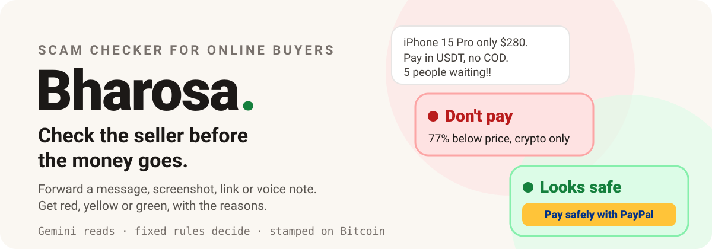
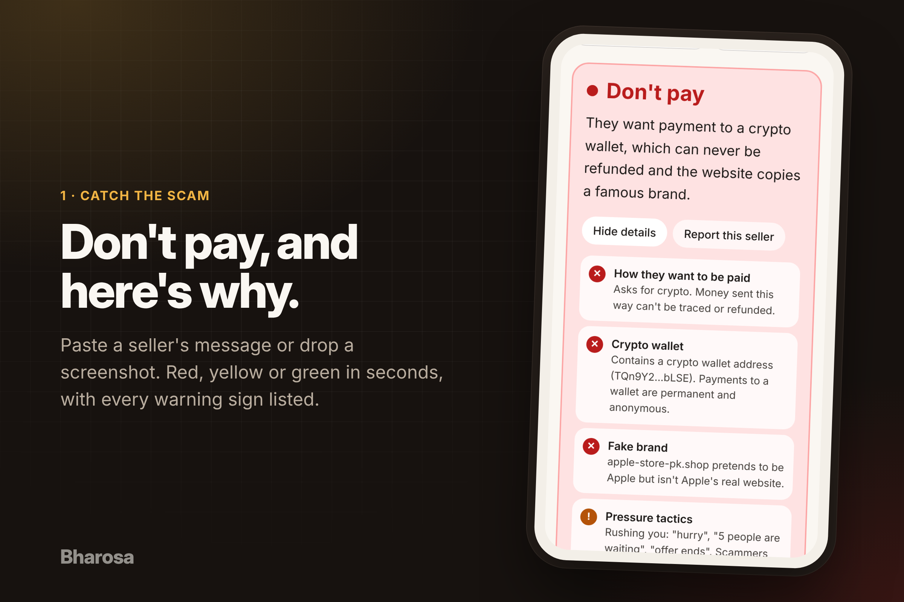
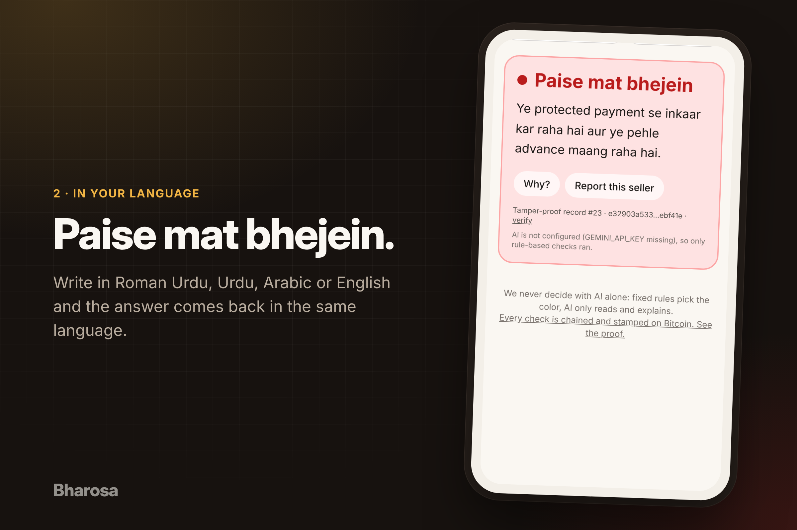
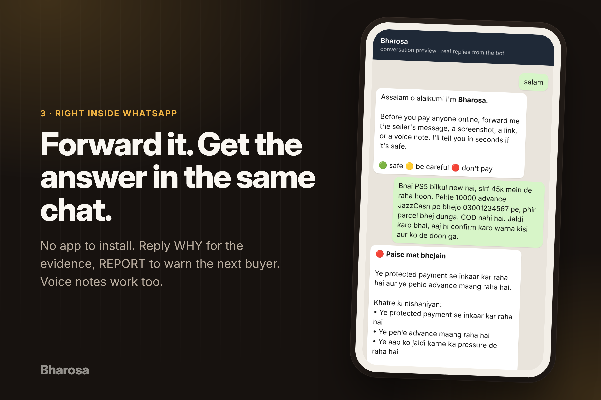
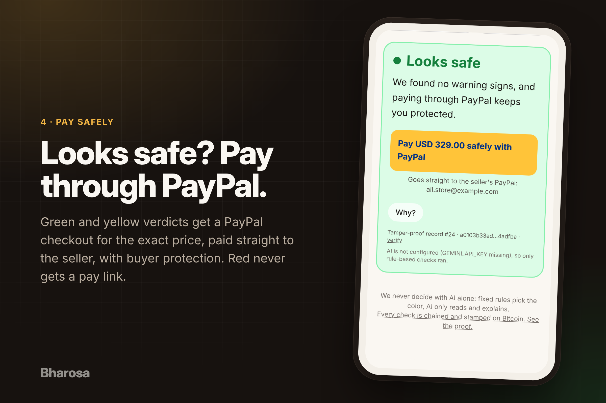
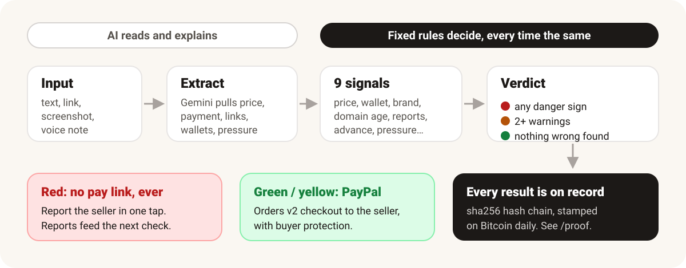

<p align="center">
  
</p>

<p align="center">
  
  
  
  
  
  
</p>

<p align="center">
  <a href="./docs/video/bharosa-demo.mp4"><b>Demo video</b></a> ·
  <a href="#quick-start"><b>Run it</b></a> ·
  <a href="#how-it-works"><b>How it works</b></a> ·
  <a href="./docs/SUBMISSION.md"><b>Devpost write-up</b></a>
</p>

People in Pakistan and the Gulf lose real money every day to sellers on WhatsApp, Instagram and OLX: a cheap iPhone paid in USDT, a room rent "advance" on Easypaisa, a prize that needs a "processing fee". **Bharosa** (Urdu for *trust*) lets a buyer forward the seller's message, screenshot, link or voice note and get one answer in seconds: **red, yellow or green**, with every reason listed, in their own language. If the deal looks safe, they pay through **PayPal** and keep buyer protection.

## See it work

<table>
  <tr>
    <td width="50%"></td>
    <td width="50%"></td>
  </tr>
  <tr>
    <td><b>Don't pay, and here's why.</b> Every warning sign is listed, and the seller can be reported in one tap.</td>
    <td><b>In the buyer's language.</b> English, Urdu, Roman Urdu or Arabic in, the same language out.</td>
  </tr>
  <tr>
    <td></td>
    <td></td>
  </tr>
  <tr>
    <td><b>Right inside WhatsApp.</b> Forward a message, screenshot or voice note. Reply WHY or REPORT.</td>
    <td><b>Looks safe? Pay through PayPal.</b> Straight to the seller, with buyer protection. Red never gets a pay link.</td>
  </tr>
</table>

Every check, report and payment is also written to a tamper-evident hash chain stamped on Bitcoin, viewable on the public **`/proof`** page.

## What makes it different

- **AI reads, rules decide.** Gemini only extracts facts and writes the explanation. Fixed rules in [`lib/check/verdict.ts`](lib/check/verdict.ts) pick the color, so a seller can't talk the model into a green and every result is repeatable.
- **Red can never pay.** The PayPal order is only created for green and yellow verdicts. That rule is enforced in code, not in a prompt.
- **Built for the people who get scammed.** Roman Urdu, Urdu script, Arabic, voice notes, WhatsApp, PKR prices converted for PayPal, big type for cheap phones.
- **Nobody can quietly rewrite history.** A sha256 chain plus daily OpenTimestamps stamps on Bitcoin. Anyone can re-verify it.
- **Private by design.** Phone numbers and handles are stored only as salted HMAC fingerprints.
- **Never fully breaks.** With zero API keys it still runs the rule checks, and PayPal has a clearly labelled demo mode.

## How it works

<p align="center">
  
</p>

| Signal | Red when | Yellow when |
|---|---|---|
| Price | >60% below market | >40% below market |
| Payment method | crypto, gift cards, Western Union, or refuses protection | direct transfer only, friends & family |
| Crypto wallet | a BTC / ETH / TRON address is in the message | |
| Fake brand | domain imitates a known brand (apple-store-pk.shop, paypa1.com) | handle like @apple_official_store |
| Website | on Google Safe Browsing, or registered <7 days ago | registered <30 days ago |
| Community reports | 3+ people reported this seller | 1–2 reports |
| Advance payment | | wants money first, unprotected |
| Pressure | | "only today", "5 people waiting", "jaldi karo" |
| Account age | | seller account <30 days old |

All rules live in `lib/check/`. The web page and WhatsApp (`lib/channels/whatsapp/`) both call the same `runCheck()`.

All rules live in `lib/check/`. The web page and WhatsApp (`lib/channels/whatsapp/`) both call the same `runCheck()`.

## How Bharosa uses PayPal and AI

**PayPal developer platform (sandbox):**

| PayPal tool | What it does in Bharosa |
|---|---|
| OAuth 2.0 client credentials (`/v1/oauth2/token`) | Server-side access token, cached until expiry (`lib/paypal.ts`) |
| Orders API v2: create order (`/v2/checkout/orders`) | Makes the "Pay safely with PayPal" checkout for the exact price on green/yellow verdicts, with the seller as payee when they gave a PayPal email. Red verdicts never get an order. |
| Orders API v2: capture (`/v2/checkout/orders/{id}/capture`) | Captures the payment when the buyer returns from PayPal (`app/api/paypal/return`) |
| Webhooks + verify-webhook-signature (`/v1/notifications/verify-webhook-signature`) | Receives `PAYMENT.CAPTURE.COMPLETED`, `DENIED`, `REFUNDED` and `CUSTOMER.DISPUTE.CREATED`, verified with PayPal before acting. A dispute is filed as a scam report against that seller (`app/api/paypal/webhook`, `lib/paypal-webhook.ts`). |

**AI:**

| AI tool | What it does in Bharosa |
|---|---|
| Google Gemini 3 Flash (fallback: 3.1 Flash-Lite), free tier, REST API | Reads the forwarded text or chat screenshot (vision) and extracts seller, price, payment method, links, phone numbers, wallet addresses and pressure phrases as strict JSON; estimates the typical market price; transcribes WhatsApp voice notes; writes the one-line explanation in the user's language (`lib/check/extract.ts`, `transcribe.ts`, `explain.ts`) |

The AI never decides the verdict. Fixed rules in `lib/check/verdict.ts` pick red / yellow / green from the signals, so every result is repeatable and explainable.

**Other tools:** Next.js 14, TypeScript, Tailwind, Supabase (Postgres + RLS), Twilio WhatsApp API, OpenTimestamps (Bitcoin anchoring), RDAP (domain age), Google Safe Browsing (optional), Vercel (hosting + cron). No hackathon sponsor tools were used.


**Built with AI assistance:** Claude (Anthropic) was used as a coding assistant during development. The explainer video narration and music were generated with ElevenLabs.

## Quick start

```bash
npm install
cp .env.example .env.local   # every key is optional
npm run dev                  # http://localhost:3000
```

With no keys at all, the rule-based checks still run. Add keys one at a time:

| What | Where (all free) | Unlocks |
|---|---|---|
| `GEMINI_API_KEY` | https://aistudio.google.com/apikey | Reading screenshots, market-price check, natural explanations |
| `PAYPAL_CLIENT_ID` / `PAYPAL_CLIENT_SECRET` | https://developer.paypal.com → Apps & Credentials → Sandbox → Create App | "Pay safely with PayPal" button |
| `SUPABASE_URL` / `SUPABASE_SERVICE_ROLE_KEY` | Supabase → Project Settings → API | History, scam reports, hash chain |
| `HASH_SALT` | `node -e "console.log(require('crypto').randomBytes(32).toString('hex'))"` | Private fingerprints |
| `SAFE_BROWSING_API_KEY` | Google Cloud console → Safe Browsing API | Known-malicious link check |

> **No PayPal keys yet?** Set `PAYPAL_DEMO=true`. The pay button then opens a demo checkout that is labelled as a demo on every screen and moves no money, so the whole flow can still be shown.

<details>
<summary><b>Supabase setup</b></summary>

Open your project → **SQL Editor** → paste all of `supabase/setup.sql` → **Run**. (It's the two migrations in `supabase/migrations/` combined, and safe to run twice.)
It creates `checks`, `payments`, `reports`, `ledger`, the `append_ledger()` function and turns on row-level security.
</details>

<details>
<summary><b>PayPal sandbox test</b></summary>

1. In the PayPal developer dashboard, open **Sandbox accounts** and note the personal (buyer) account email + password.
2. Check the "Normal headphones sale" example → click **Pay safely with PayPal** → log in with the sandbox buyer.
3. You're redirected back with "Payment done". The capture is stored and chained.

PayPal doesn't take PKR, AED, SAR or INR, so those prices are converted to USD using `FX_TO_USD` (approximate demo rates, update before demo day).
</details>

<details>
<summary><b>WhatsApp (Twilio sandbox, free)</b></summary>

People forward a seller's message, screenshot or voice note to a WhatsApp number and get the verdict back in the same chat, in their language.

1. Run `supabase/migrations/0002_whatsapp.sql` in the Supabase SQL Editor.
2. Create a free Twilio account → **Messaging → Try it out → Send a WhatsApp message**. Join the sandbox from your phone by sending the `join <word>` code it shows to **+1 415 523 8886**.
3. Put `TWILIO_ACCOUNT_SID` and `TWILIO_AUTH_TOKEN` (Console home page) in `.env.local`.
4. Give Twilio a public URL:
   - **Deployed:** `https://your-app.vercel.app/api/whatsapp`
   - **Local:** `npx ngrok http 3000` → `https://<id>.ngrok-free.app/api/whatsapp`
5. Paste that URL into the sandbox settings, **When a message comes in**, method **POST**. Put the same URL in `TWILIO_WEBHOOK_URL`, restart `npm run dev`.
6. Send the bot a message from your phone.

What it understands:

| Send | Bharosa replies |
|---|---|
| Seller's text or a link | 🔴/🟡/🟢 verdict, reason, warning signs, PayPal pay link if safe |
| Chat screenshot | Same, read by the AI |
| Voice note (Urdu, English, Arabic) | Shows what it heard, then the verdict |
| `WHY` / `kyun` | Every check with its evidence |
| `REPORT` | Reports the last seller to the community network |
| `hi` / `salam` / `help` | How to use it |

Replies come in English, Urdu, Roman Urdu or Arabic, matching the sender. Twilio waits only 15 seconds for a reply, so if a check is slow Bharosa answers "checking..." and sends the verdict as a follow-up message.

**Test without a phone:** with `npm run dev` running and any `TWILIO_AUTH_TOKEN` set,

```bash
npm run wa -- "Bhai PS5 sirf 45k, pehle advance JazzCash pe bhejo, COD nahi hai"
npm run wa -- WHY
npm run wa -- REPORT
```

The simulator signs its requests exactly like Twilio, so it exercises the real security check.
</details>

<details>
<summary><b>PayPal webhooks</b></summary>

Payments, refunds and disputes update automatically, even if the buyer closes the tab before PayPal redirects them back.

1. Deploy (or run ngrok) so you have a public https URL.
2. developer.paypal.com → your sandbox app → **Webhooks → Add webhook**, URL `https://<your-app>/api/paypal/webhook`.
3. Tick **PAYMENT.CAPTURE.COMPLETED, PAYMENT.CAPTURE.DENIED, PAYMENT.CAPTURE.REFUNDED, CUSTOMER.DISPUTE.CREATED**.
4. Copy the **Webhook ID** into `PAYPAL_WEBHOOK_ID`.

Every webhook is checked with PayPal's verify-signature API before anything happens. A dispute on a Bharosa payment also counts as a scam report against that seller.

**Paying the seller directly:** if the seller's message includes their PayPal email ("PayPal: ali@example.com"), the pay link sends the money straight to them, with buyer protection. If PayPal rejects that email (in the sandbox, it must be a sandbox account), the payment falls back to the Bharosa account and the result says so.
</details>

<details>
<summary><b>Bitcoin anchoring and the Proof page</b></summary>

Once a day, Bharosa stamps the newest hash in its chain on Bitcoin through [OpenTimestamps](https://opentimestamps.org): free, no wallet, no crypto needed. Because every record includes the hash before it, one stamp covers the whole history.

- Set `CRON_SECRET` (any long random string). On Vercel, `vercel.json` runs the stamp daily at midnight Pakistan time.
- Run it by hand: `curl -X POST -H "Authorization: Bearer $CRON_SECRET" https://<your-app>/api/anchor`
- **`/proof`** is the public page for judges: chain status, live stats, recent records (hashes only), and each Bitcoin stamp with its file and `.ots` proof. Drop both onto opentimestamps.org to see the Bitcoin block. A fresh stamp takes a few hours to reach a block.
</details>

<details>
<summary><b>Deploy on Vercel (free)</b></summary>

1. Go to **vercel.com/new**, choose **Import Git Repository**, and pick `hashirsakimdad/Bharosa`. If it isn't listed, click **Adjust GitHub App Permissions** and allow the repo.
2. Leave the framework as **Next.js** and the build settings as default.
3. Open **Environment Variables** and add everything from your `.env.local`:
   `GEMINI_API_KEY`, `PAYPAL_CLIENT_ID`, `PAYPAL_CLIENT_SECRET`, `SUPABASE_URL`, `SUPABASE_SERVICE_ROLE_KEY`, `HASH_SALT`, `CRON_SECRET`, `TWILIO_ACCOUNT_SID`, `TWILIO_AUTH_TOKEN`, `TWILIO_WHATSAPP_FROM`, `FX_TO_USD`.
   Don't add `TWILIO_SKIP_SIGNATURE`.
4. Click **Deploy**. When it finishes, copy your URL (like `https://bharosa-xyz.vercel.app`).
5. Add three more variables with that URL, then go to **Deployments → ⋯ → Redeploy**:
   - `APP_URL=https://bharosa-xyz.vercel.app`
   - `TWILIO_WEBHOOK_URL=https://bharosa-xyz.vercel.app/api/whatsapp`
   - `PAYPAL_WEBHOOK_ID=` (after step 7)
6. In Twilio's WhatsApp sandbox settings, set **When a message comes in** to `https://bharosa-xyz.vercel.app/api/whatsapp` (POST).
7. In the PayPal developer dashboard, add a webhook for `https://bharosa-xyz.vercel.app/api/paypal/webhook` (events listed above) and put its ID in `PAYPAL_WEBHOOK_ID`.

From then on, every push to `main` deploys automatically, and the daily Bitcoin stamp runs on its own (`vercel.json`).
</details>

## Tests

```bash
npm test                # 47 offline tests: rules, verdicts, hash chain, privacy, SSRF, WhatsApp, PayPal webhooks, Bitcoin stamps. No keys, no network.
npm run dev             # then in a second terminal:
npm run test:fixtures   # runs the demo cases through the real API and prints verdicts
```

## Security

<details>
<summary><b>Hash chain, privacy, abuse limits, SSRF, webhook verification</b></summary>

- **Hash chain** (`lib/ledger.ts`, `append_ledger()` in SQL): `entry_hash = sha256(prev_hash | seq | kind | payload_hash | time)`. Appends are serialized with a lock, the table blocks UPDATE/DELETE with a trigger, and `GET /api/ledger/verify` re-walks the chain and re-hashes every stored check and report. Edit or delete any record and verification fails at that entry.
- **Privacy:** phones, handles and reporter IPs are stored as HMAC-SHA256 fingerprints with `HASH_SALT`. Phone formats are normalized so `+92 300 1234567` and `03001234567` match.
- **Report abuse protection:** you can only report a seller from a real stored check, one report per person per seller, max 5 reports/hour per IP. Counts use distinct reporters.
- **SSRF protection** for image links: https only, port 443, every resolved IP must be public, redirects re-checked, 5 MB cap, image types only.
- **Rate limits:** 10 checks/minute per IP (in-memory; move to Redis or a table for multi-instance production).
- **Row-level security** on all tables with no public policies. Only the server's service role key can read or write.
- Input size limits and schema validation on every endpoint.
- **PayPal webhooks:** verified with PayPal's verify-signature API, sending the event exactly as received (re-encoding it can break genuine signatures); certificate URLs must be on paypal.com; repeats are ignored and every handler is idempotent.
- **Anchoring endpoint** is locked behind `CRON_SECRET` (constant-time compare). A broken chain is never anchored.
- **WhatsApp webhook:** every request must carry a valid Twilio signature (HMAC-SHA1, constant-time compare) or it gets 403. Media is only downloaded from `api.twilio.com`. Duplicate deliveries are ignored, each sender is rate-limited (6 checks/minute, 5 reports/hour), and sender numbers are stored only as fingerprints.
</details>

**Known limitations:** the DNS check in the image fetcher has a small DNS-rebinding window; the in-memory rate limiter resets on redeploy; market prices are AI estimates and marked as such in the UI.

## Project layout

```
app/                 pages (landing, /proof, demo checkout) and API routes
  api/check          the web check endpoint
  api/whatsapp       Twilio webhook
  api/paypal         return + verified webhooks
  api/anchor         daily Bitcoin stamp (cron)
lib/check/           extraction, 9 signals, verdict rules, explanations
lib/channels/        WhatsApp adapter
lib/paypal.ts        Orders v2, OAuth, demo mode
lib/ledger.ts        hash chain + verification
supabase/            schema, RLS, append_ledger()
docs/                Devpost write-up, demo script, gallery, video
```

## Credits

Built by [Hashir Sakimdad](https://github.com/hashirsakimdad) for the PayPal AI Hackathon 2026. Hackathon material is in [`docs/`](docs/): the Devpost write-up and the demo video script.

Released under the [MIT License](LICENSE).
